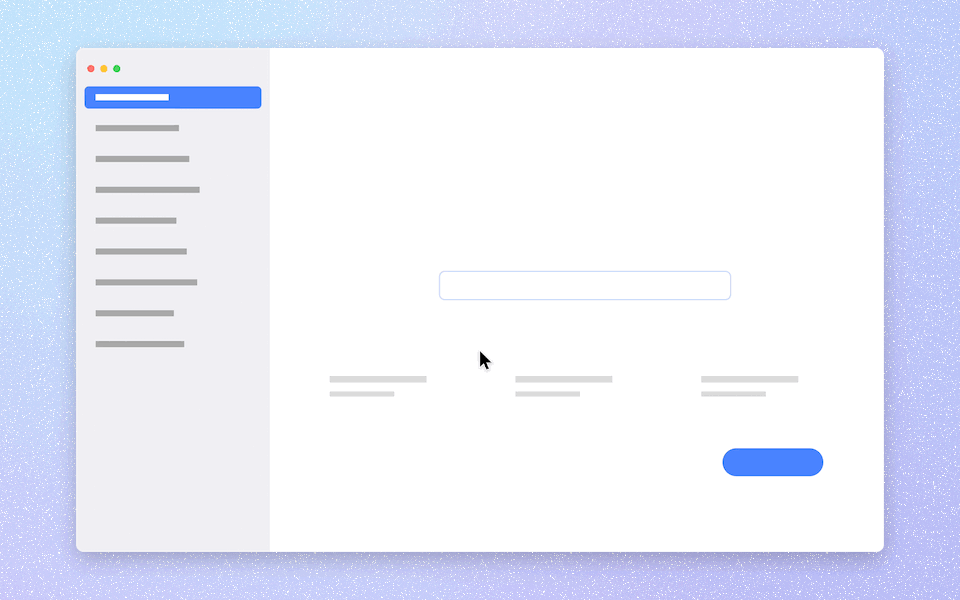
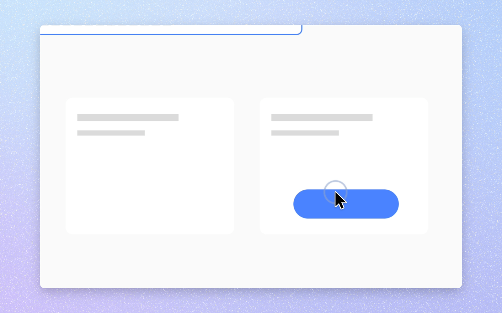

<div align="center">

# Capture Pro

**Calm, native screenshots and screen recordings for macOS.**
It lives in your menu bar, stays out of your way, and makes every recording look like a polished product demo — automatically.



</div>

---

## Why

Most screen tools are either bare (the system ones) or heavy (accounts, uploads, upsells). Capture Pro is a single small native app with no bloat, no account, no telemetry and no network access. It does two things:

- **Screenshots** — area, window or full screen, copied and saved instantly, with a quiet floating preview.
- **Recordings** — captured at full Retina resolution, then turned into a demo-quality video: a flowing gradient behind a rounded, shadowed screen, automatic zoom where you click, a camera that follows your cursor, and a smoothed, enlarged cursor with click ripples.

## Features

**Capture**
- Click the menu bar icon (or use a shortcut) to capture an area, a window or the whole screen
- Area picker with live dimensions; `Space` switches to window picking, `Shift` constrains to a square, `Esc` cancels
- Copy to clipboard, save as PNG / JPEG / HEIC, floating preview you can drag into any app
- Optional "Beautify" — screenshots get the same background, padding, corners and shadow as recordings

**Record**
- ScreenCaptureKit capture at native resolution and 30/60 fps, HEVC
- System audio and microphone (each optional)
- Countdown, a subtle frame around the recorded area, and a live timer in the menu bar — click it to stop
- The real cursor is hidden while recording and re-drawn afterwards, so it can be smoothed, enlarged and animated

**Automatic polish** (all adjustable, per recording)
- **Auto-zoom**: clicks and typing bursts become zoom segments; nearby actions merge into one smooth zoom
- **Camera**: spring-physics zoom and pan that follows the cursor with a dead-zone, never shows outside the frame, and pre-aims so zooms land exactly on target
- **Cursor**: spring-smoothed with lag compensation, enlarged high-res system cursor shapes, press animation, click ripple or halo, motion blur, hides when idle
- **Frame**: flowing mesh gradients (12 calm palettes or your own colors), linear gradients, solid colors, your desktop wallpaper or any image — with padding, corner radius, shadow, edge highlight and fine grain
- **Motion blur** on fast camera moves
- Aspect ratios: auto, 16:9, 9:16, 1:1, 4:3, 4:5

**Editor**
- Live preview, filmstrip timeline, trim handles
- Zoom track: drag zooms to move them, drag edges to resize, double-click to add, per-zoom level and fixed focus point
- Export MP4 / MOV (H.264 or HEVC, 720p–4K, 30/60 fps, quality presets) or GIF
- "Save as Default Look" makes your tweaks the default for future recordings

<p align="center"></p>

## Install

1. Download `CapturePro-x.y.z.zip` from [Releases](../../releases) and move **Capture Pro.app** to Applications.
2. The app is open source and not notarized, so the first time, **right-click → Open** (or run `xattr -dr com.apple.quarantine "/Applications/Capture Pro.app"`).
3. Grant **Screen Recording** when asked (System Settings › Privacy & Security › Screen & System Audio Recording). Optionally grant **Accessibility** so auto-zoom can react to typing — only keystroke *timing* is recorded, never which keys.

Requires macOS 15 Sequoia or later.

## Default shortcuts

| Action | Shortcut |
|---|---|
| Capture area | `⌥⇧1` |
| Capture window | `⌥⇧2` |
| Capture screen | `⌥⇧3` |
| Start / stop recording | `⌥⇧5` |

All shortcuts can be changed in Settings › Shortcuts. You can also make a left-click on the menu bar icon capture or record immediately (Settings › General).

## Build from source

No Xcode project needed — just the Swift toolchain (Xcode or Command Line Tools):

```bash
git clone https://github.com/virajdas/capture-pro.git
cd capture-pro
Scripts/build-app.sh            # → build/Capture Pro.app and dist/CapturePro-1.0.0.zip
open "build/Capture Pro.app"
```

Useful while developing:

```bash
swift build && .build/debug/CapturePro                         # run from the terminal
.build/debug/CapturePro --render-demo /tmp/demo                # render a synthetic demo through the full pipeline
.build/debug/CapturePro --open "~/Movies/Capture Pro/Recording ….capturepro"   # open a project in the editor
```

## How it works

```
ScreenCaptureKit ──► raw.mov (HEVC, cursor hidden)          ┐
InputTracker     ──► cursor path · clicks · key timing ·    ├─► project.capturepro/
                     cursor shapes (high-res PNGs)          ┘
                                     │
ZoomPlanner  ── clicks/typing ──► zoom segments (editable)
MotionTimeline ─ springs @120 Hz ─► camera + cursor state per instant (deterministic)
Compositor (Core Image) ─► background · crop/zoom · cursor · ripples · mask · shadow
AVVideoComposition ─► live preview (AVPlayer)  and  AVAssetReader → AVAssetWriter export
```

Motion is simulated once, up front, so scrubbing is free and the preview matches the export frame for frame. The research behind the defaults (spring constants, zoom timings, cursor behaviour, bitrates) is in [docs/RESEARCH.md](docs/RESEARCH.md).

Projects are plain folders (`raw.mov`, `project.json`, `cursors/`, audio), stored in `~/Movies/Capture Pro`.

## Privacy

Capture Pro makes no network requests. Recordings and screenshots stay in folders you choose. Keystroke monitoring (optional, needs Accessibility) stores timestamps only.

## License

MIT — see [LICENSE](LICENSE).
